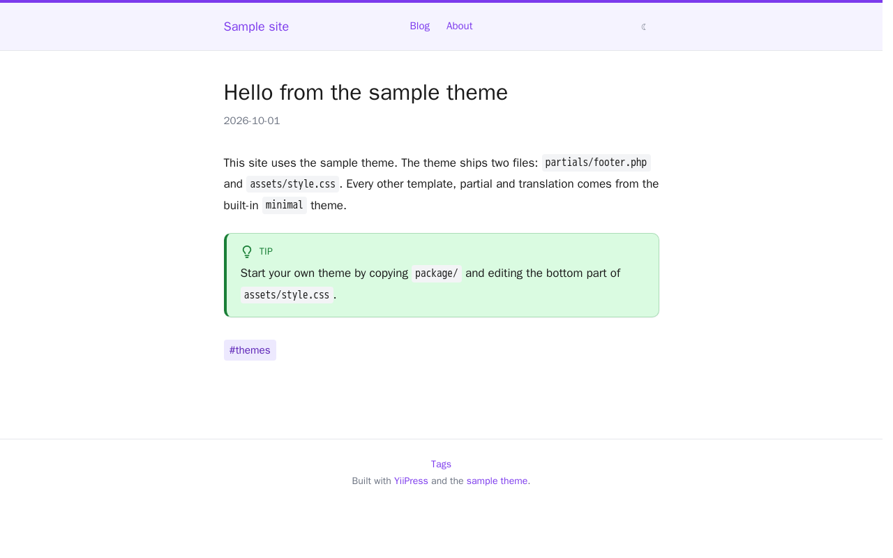

# YiiPress sample theme

A small theme for [YiiPress](https://github.com/yiipress/engine) that changes only two files of the built-in
`minimal` theme: the footer and the stylesheet. Everything else comes from `minimal`. Use it to see how an installable
theme is built, or copy it as the start of your own.



## Install

The theme needs YiiPress 0.2.0 or later. Run this in the root of your site, where you run `yiipress build`:

```shell
yiipress get:theme --url=https://github.com/yiipress/theme-sample
```

YiiPress picks the newest release that supports your version, installs `package/` into `themes/theme-sample`,
records it in `yiipress.lock` and sets `theme: theme-sample` in `content/config.yaml`. Commit `themes/`,
`yiipress.lock` and `config.yaml` with your site; add `.yiipress/` to `.gitignore`. Updating, removing and restoring
the theme are covered in the [extension docs](https://github.com/yiipress/engine/blob/master/docs/extensions.md).

## What is in the repository

```text
extension.yaml               the manifest: ID, version, supported YiiPress versions, license, theme fields
package/                     the installed files
├── assets/style.css         minimal's style.css, then the sample's changes below «Sample theme»
└── partials/footer.php      minimal's footer with a credit line
screenshots/home.png         shown in the catalog; not installed
example/content/             a small site to try the theme
.github/workflows/           checks the manifest and builds the example on every push
```

`extension.yaml` sets `fallback: minimal`, so every template, partial, translation and asset the theme does not
have is taken from `minimal`. A theme that ships `assets/style.css` replaces the stylesheet of `minimal` as a whole,
which is why this one starts with a copy of it.

## Try the example

```shell
mkdir -p example/themes
cp -r package example/themes/theme-sample
cd example
yiipress serve
```

## Make your own theme

1. Copy this repository. Change `id` (`<your GitHub user or organization>/<name>`), `name`, `description`,
   `authors`, `homepage` and `license` in `extension.yaml`. The theme installs into `themes/<name>`.
2. Change or add files in `package/`: any template or partial of `minimal` (`entry.php`, `partials/header.php`, …)
   or asset. Template variables are listed in the
   [templates docs](https://github.com/yiipress/engine/blob/master/docs/templates.md).
3. Replace `screenshots/home.png`.
4. Push, let the workflow check the manifest, then publish a GitHub release whose tag matches `version`
   (`v1.0.0` for `version: 1.0.0`).
5. To list it in the [YiiPress extension catalog](https://github.com/yiipress/catalog), open a pull request there
   that adds `extensions/<vendor>/<name>.yaml`.

## License

BSD-3-Clause, see [LICENSE.md](LICENSE.md).
